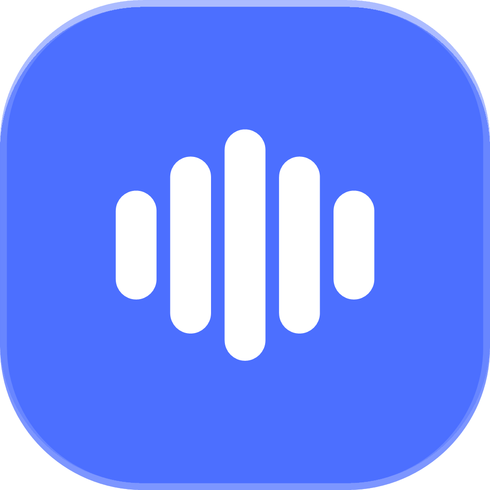

<p align="center">
  
</p>

<h1 align="center">SpotiKit</h1>

<p align="center">
  Give Spotify a new look and new features.<br>
  Pick themes and extensions right inside Spotify, install them with one click and switch back anytime.
</p>

<p align="center">
  <a href="https://spotikit.com">Website</a> ·
  <a href="https://spotikit.com/docs/introduction">Docs</a> ·
  <a href="https://github.com/NMWplays/SpotiKit/releases">Releases</a>
</p>

<p align="center">
  
  
  
</p>

---

## What is SpotiKit

SpotiKit lets you change how Spotify looks and add new features to it. It's free.

- **Themes** give Spotify a new look.
- **Extensions** add new buttons and features.
- **Custom apps** add whole new pages to Spotify.
- **CSS snippets** are small tweaks, like rounder corners or hiding a button.
- **Setup profiles** save which theme, extensions and snippets are on, so you can switch between looks with one click.

You find all of it in the Marketplace, a page right inside Spotify. Glowify, Liquify and Liquid Lyrics are the first themes and extensions made for SpotiKit.

## What you can do

**In Spotify**

- **Themes and extensions.** Browse them right inside Spotify. One click to install, one click to remove.
- **Your colors.** Change the colors of any theme and watch Spotify change with you. Share your colors with friends.
- **Small tweaks.** CSS snippets for rounder corners, hidden buttons and more. Mix them on top of any theme.
- **Made for your Spotify.** Everything says which Spotify versions it works on, so nothing breaks by surprise.
- **Setup profiles.** Save your theme and extensions as a profile and switch with one click. Upload it so others can use it too.
- **Ratings and reviews.** See what others think before you install, and leave a review yourself. Creators can answer them.
- **Updates and undo.** Installed themes and extensions update with one click. Didn't like the update? Go back to the last one.
- **Watched over.** Anything harmful gets removed from the Marketplace and switched off for everyone who has it.

**In the SpotiKit app**

- **One click to install.** Install or remove SpotiKit with one click. Your PC is checked before anything changes.
- **Nothing gets lost.** SpotiKit saves a copy of Spotify before every change. Uninstall it and Spotify is back to normal.
- **Spotify update protection on Windows.** Spotify only updates once SpotiKit is ready for the new version.
- **Safe mode.** Something acting up? Start Spotify with everything off, then turn things back on one by one.
- **Updates itself on Windows.** New versions of SpotiKit install by themselves.

## Status

SpotiKit **0.9.2** is in open beta. Some things may still be rough. If something breaks or looks off, tell us in the [issues](https://github.com/NMWplays/SpotiKit/issues).

| Platform | State |
| --- | --- |
| Windows 10 and 11 | Open beta |
| Linux | Planned. Most of it already works, but Flatpak, AUR and other installs still need work. |
| macOS | Experimental |

You need Spotify from [spotify.com](https://www.spotify.com/download). The version from the Microsoft Store doesn't work.

## Install

On macOS, [build and open SpotiKit from source](#run-on-macos).

On Windows, download SpotiKit from [spotikit.com](https://spotikit.com) or [GitHub Releases](https://github.com/NMWplays/SpotiKit/releases).

1. Download `SpotiKit.exe` and run it.
2. Open **Installation** and press **Install SpotiKit**.
3. Spotify starts again with SpotiKit. Open the Marketplace with the shopping bag icon next to the back and forward arrows.

To get plain Spotify back, press **Uninstall** in the same place. The [docs](https://spotikit.com/docs/installation) explain every step.

## Make your own

Want to build a theme, extension, app or snippet yourself? Open **Developer** in the SpotiKit app and start from a template, in JavaScript or TypeScript. You see your changes in Spotify while you work, and **Check** tells you what would break before you publish.

Your projects are in `%APPDATA%\SpotiKit\Themes`, `Extensions`, `Custom Apps` and `Snippets`, and go into Spotify with **Apply to Spotify**.

If you work in a Git repository, there's `spotikit-kit` ([`tools/kit`](tools/kit)). Start with `npm create spotikit`, then use `spotikit-kit build`, `check`, `dev` (live in Spotify) and `pack`. New projects come with a GitHub workflow that builds, checks and makes releases for you.

You'll find examples in [`examples/`](examples) and a full guide in the [docs](https://spotikit.com/docs/development).

To put your project in the Marketplace, publish it in a public GitHub repository and give it the topic `spotikit-themes`, `spotikit-extensions`, `spotikit-apps` or `spotikit-snippets`. The Marketplace finds it by itself.

## Build from source

You need the [.NET 10 SDK](https://dotnet.microsoft.com/download).

```
dotnet run --project SpotiKit.csproj
dotnet test tests/SpotiKit.Tests
```

### Run on macOS

With the .NET 10 SDK installed, run this from the repository root.

```sh
app_path="$(./tools/macos/build-dev-app.sh)" && open "$app_path"
```

This builds for your Mac and opens SpotiKit with your usual Spotify installation. To reopen it in Finder, find `SpotiKit.app` under `bin/macos-app/`. Quit SpotiKit before rebuilding.

Development builds lack a Developer ID signature and notarization. If macOS shows a developer verification warning after you try to open your build, go to **System Settings → Privacy & Security**. Scroll to **Security**, click **Open Anyway**, then confirm **Open**. [Apple’s instructions for opening an app you trust](https://support.apple.com/en-us/102445)

To test with a separate copy of Spotify, run `./tools/run-macos-dev.sh --full-bundle`. [Mac development and validation notes](docs/macos-validation.md)

## License

[AGPL-3.0](LICENSE).

Parts of SpotiKit's JavaScript API are based on [Spicetify](https://github.com/spicetify/cli) (LGPL-2.1). [THIRD-PARTY-NOTICES.md](THIRD-PARTY-NOTICES.md) lists them.

SpotiKit is an independent project. It is not affiliated with or endorsed by Spotify AB. Spotify is a trademark of Spotify AB.
